<p align="center">
  <picture>
    <source media="(prefers-color-scheme: dark)" srcset="docs/images/header-dark.png">
    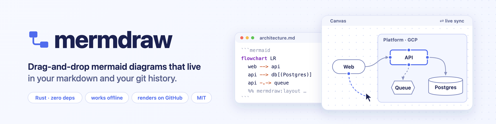
  </picture>
</p>

<p align="center">
  <a href="https://github.com/berttoli/mermdraw/actions/workflows/ci.yml"></a>
  <a href="LICENSE"></a>
  
  
</p>

**mermdraw** is a tiny local editor for the mermaid diagrams inside your markdown. Point it at a file, drag boxes
around, connect them, drop in logos, and every change is written straight back into the ```` ```mermaid ```` block, ready
to commit and review like any other change. It's a draw.io / Miro-style canvas that keeps your architecture as
plain text in your repo.

```bash
mermdraw docs/architecture.md        # opens the editor in your browser
```

<picture>
  <source media="(prefers-color-scheme: dark)" srcset="docs/images/hero-dark.png">
  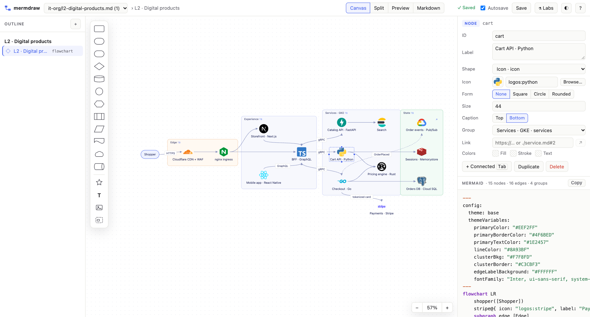
</picture>

> **Status: 0.1, early.** Expect rough edges. [Issues](https://github.com/berttoli/mermdraw/issues) and ideas welcome.

## Features

**Visual canvas for flowcharts**
- Drag, drop and connect: pull a node's ● handle onto another node, or onto empty space to create the next node.
  Press <kbd>Tab</kbd> while naming a node to chain the next one.
- All 43 mermaid shapes, person, browser, console, folder and bucket among them, plus free text, images (drop or paste
  one and it's saved to `assets/`) and product icons.
- Subgraphs: <kbd>⌘G</kbd> to group, drag nodes into or out of a box, nest groups, set a direction per group, collapse
  a group into one box (`view: collapsed`).
- A Miro-style toolbar floats over the selection: line ends, swap, line style, a per-line shape (curved, straight,
  elbow) and color; node shape, fill and border; group direction and fill; align, group and duplicate.
- Double-click a node, line or group to edit its label or title.
- Inspector: rename ids (every reference follows), labels, shapes, links, colours (`style` / `linkStyle`), classes,
  and edge style (solid, thick, dotted, invisible, arrowheads, length).
- Box-select, align and distribute, duplicate, copy as mermaid / paste mermaid, undo/redo, zoom, pan and fit.
  **Auto-layout** snaps the canvas to mermaid's own layout.

**Code and live preview for every diagram type**
- Four views: **Canvas**, **Split**, **Preview**, and **Markdown** for editing the whole file.
- A syntax-highlighted code pane. Typing updates the canvas and preview immediately.
- The real mermaid 12.2.0 renderer is embedded (works offline), the same version GitHub renders with, so the preview
  shows what GitHub draws; export it as SVG.
- An outline of the file's headings and diagrams. Add diagrams from nine templates (flowchart, sequence, class,
  state, ER, architecture, C4, gantt, mindmap) or delete them.

**Markdown-native and git-friendly**
- Only the block you edit changes. Prose, other blocks, line endings and indentation are left alone. `.md` and
  `.mmd` both work.
- Autosave (or <kbd>⌘S</kbd>) with atomic writes. Edits made in vim or VS Code reload live, and if both sides changed
  the file, mermdraw re-applies your diagram on top of theirs instead of overwriting them.
- Stable, canonical output with readable ids (`Auth Service` → `authService`). Canvas positions live in a single
  `%% mermdraw:layout` comment that mermaid ignores.

**Architecture tooling: L1 → L2**
- **Icon packs:** `mermdraw icons add logos devicon` installs ~3,300 open-licensed logos (Python, Rust, nginx, Postgres,
  Kubernetes, Cloud Run, Okta, Grafana, Proxmox…), globally or vendored into the repo. Find them with a searchable picker.
- **Drill-down:** link a node to another diagram (`./l2-platform.md#2`). <kbd>⌘</kbd>-click drills in, and a
  **← back** chip (<kbd>⌘[</kbd>) returns.
- **Diagram styles** (Labs): palettes, neo / classic / hand-drawn looks and orthogonal lines, written as mermaid
  frontmatter config, so GitHub renders them too.

**Small and safe**
- One ~2.2 MB std-only Rust binary: no runtime, no dependencies, starts instantly. `--app` opens a chromeless window.
- Listens on `127.0.0.1` only, rejects foreign `Host` headers, never leaves the folder it serves, and only accepts
  image uploads.

| | |
| --- | --- |
| 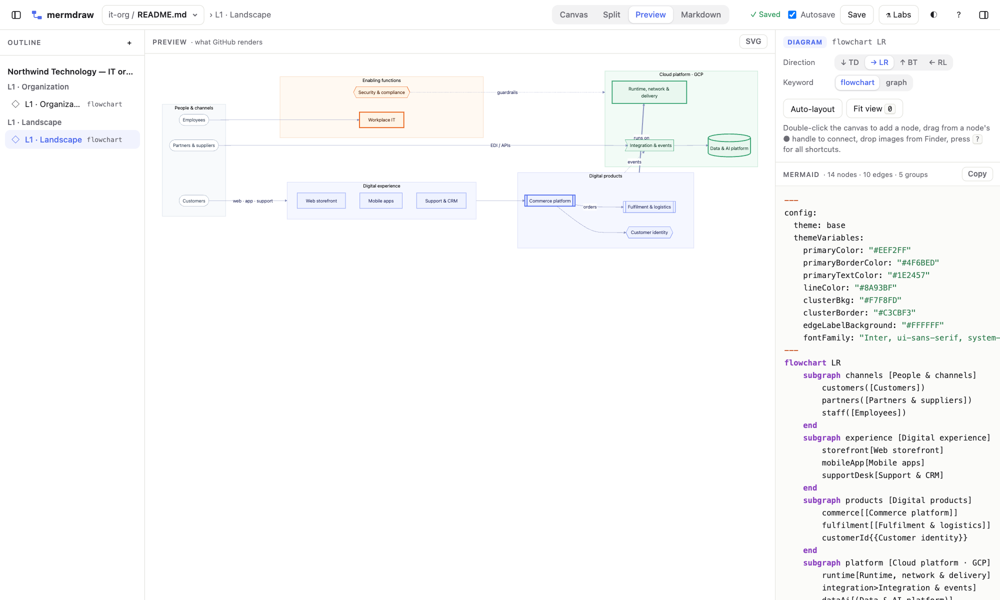 **L1** in the preview: exactly what GitHub renders | 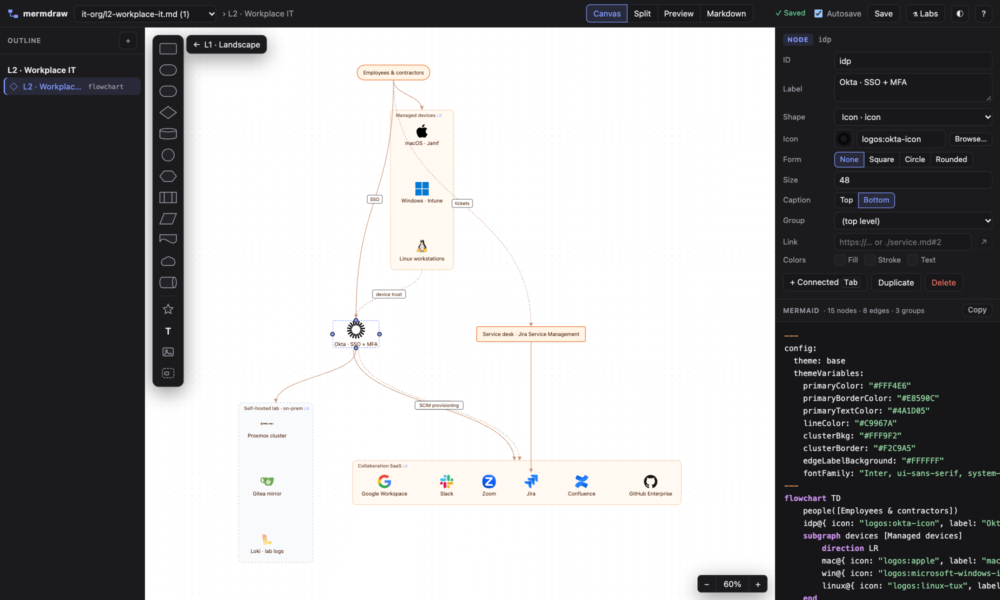 **⌘-click drill-down** from L1 into an L2 |
| 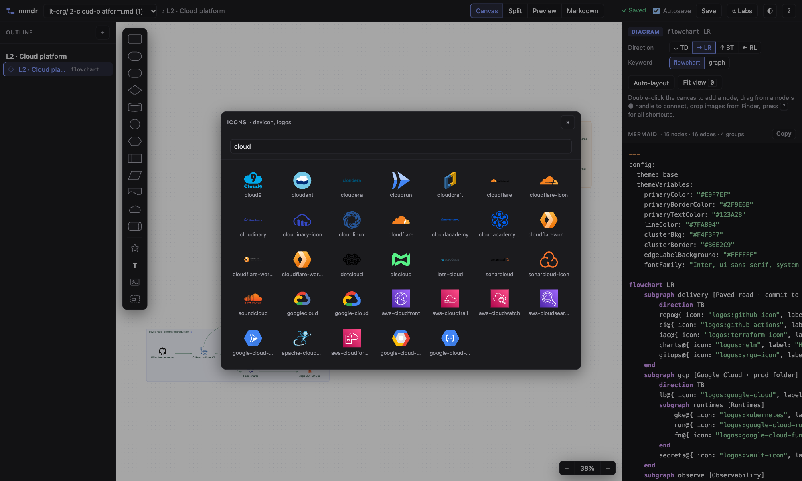 **Icon picker** over installed Iconify packs | 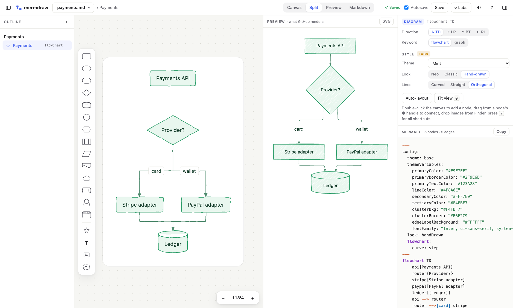 **Diagram styles**: theme, hand-drawn, orthogonal |
| 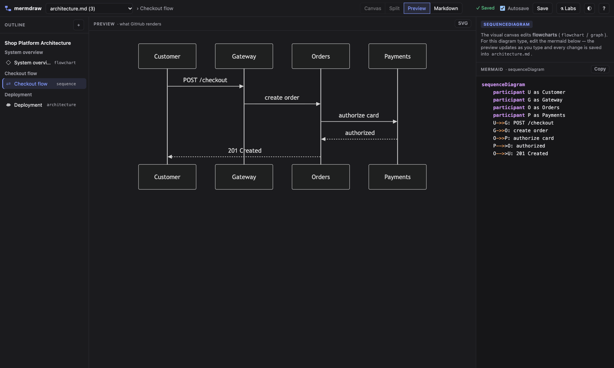 **Any diagram type** as code with a live preview | 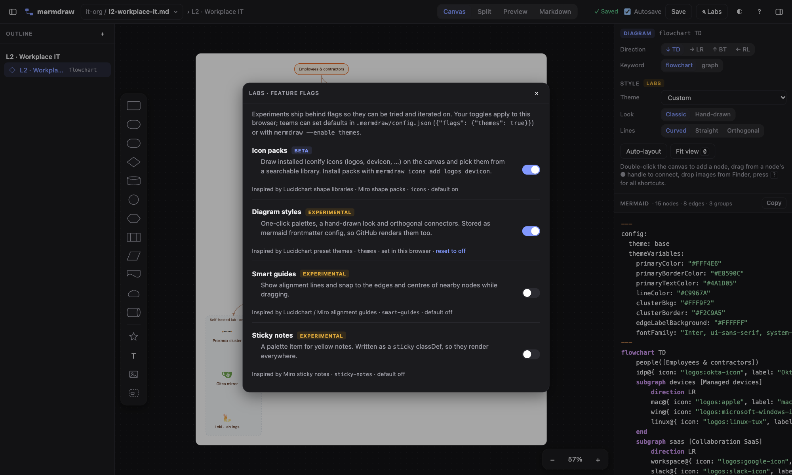 **Labs**: experiments behind feature flags |

## Install

Download a binary from the [releases page](https://github.com/berttoli/mermdraw/releases). The Linux builds are static
and run on any distro. Asset names don't change between versions, so this always fetches the latest stable release:

```bash
# pick yours: aarch64-apple-darwin, x86_64-apple-darwin, x86_64-unknown-linux-musl, aarch64-unknown-linux-musl
target=aarch64-apple-darwin
curl -fsSL "https://github.com/berttoli/mermdraw/releases/latest/download/mermdraw-$target.tar.gz" | tar xz
sudo mv "mermdraw-$target/mermdraw" /usr/local/bin/
```

For a specific version, use `download/<tag>` instead of `latest/download`, e.g.
`https://github.com/berttoli/mermdraw/releases/download/v0.1.0/mermdraw-$target.tar.gz`; `mermdraw --version` tells
you which build you have. Release candidates are published as pre-releases, which `latest` skips.

On Windows, download `mermdraw-x86_64-pc-windows-msvc.zip`. Every archive is listed in `SHA256SUMS.txt` and carries a
signed build-provenance attestation (`gh attestation verify <archive> -R berttoli/mermdraw`). If macOS refuses to open a
binary downloaded in a browser, run `xattr -d com.apple.quarantine mermdraw`.

The editor opens in your browser and needs a current Chrome, Edge or Firefox, or Safari 17.4 or later (mermaid 12's
minimum).

Or build it with Rust:

```bash
cargo install --git https://github.com/berttoli/mermdraw
```

Optional, for L2 diagrams with product logos:

```bash
mermdraw icons add logos devicon            # into ~/.config/mermdraw/icons, available everywhere
mermdraw icons add logos --vendor           # or into this repo's .mermdraw/icons so teammates get them too
```

## Quick start

```bash
mermdraw new docs/architecture.md --title "System overview"   # creates the file with a starter flowchart
mermdraw docs/architecture.md                                  # edit it in the browser; changes save as you go
git diff docs/architecture.md                                  # review it like any other change
```

Then try the [IT organization example](examples/it-org/README.md): `mermdraw examples/it-org/README.md` and ⌘-click a
thick-bordered box to drill from the L1 landscape into an L2.

## Examples

**What a canvas edit writes.** Starting from a hand-written block, drag the nodes around and press <kbd>Tab</kbd> on
`Orders service` to add a cache. mermdraw rewrites the block like this:

````markdown
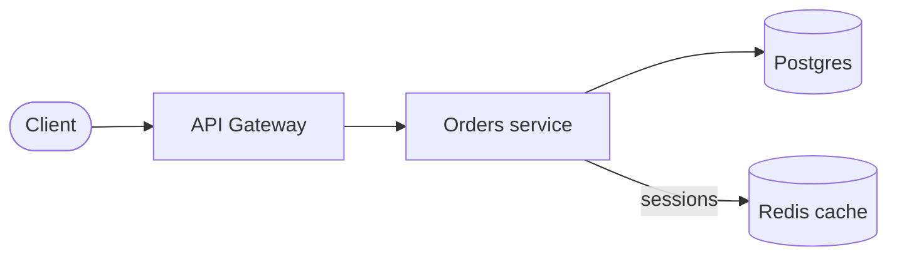
````

**An L1 that renders anywhere**, linking down to its L2s. Only classic shapes, a theme and classDefs are used, so this
is GitHub rendering it right here:

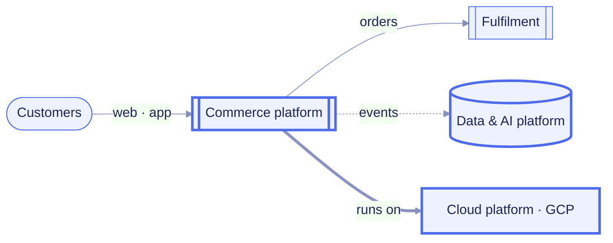

**L2 nodes with product icons**: mermaid's own icon syntax, drawn with the packs you installed:

````markdown
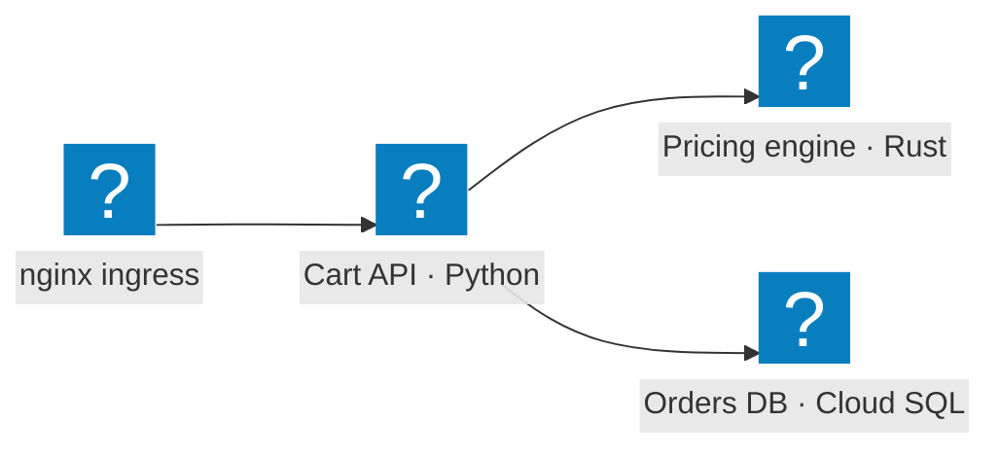
````

**Diagram styles** chosen in the inspector (Labs → Diagram styles) become plain mermaid config:

````markdown
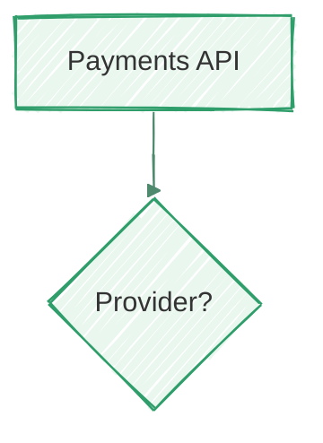
````

**Team defaults** for experiments go in `.mermdraw/config.json`:

```json
{ "flags": { "themes": true, "smart-guides": true } }
```

**Scripting** from the terminal or CI:

```bash
mermdraw ls docs/architecture.md                       # inventory: index, type, line range, title
mermdraw cat docs/architecture.md 2 > checkout.mmd     # extract one diagram's source
mermdraw new docs/adr/0042.md -t sequence --title "Token refresh"
```

## Reference

<details>
<summary><b>Command line</b></summary>

```
mermdraw [PATH]              open a .md/.mmd file or a directory (default: .)
mermdraw ls FILE             list the diagrams in FILE
mermdraw cat FILE [N]        print diagram N's source
mermdraw new FILE [-t TYPE] [--title TITLE]
                             append a diagram (flowchart, sequence, class, state, er,
                             architecture, c4, gantt, mindmap); creates FILE if needed
mermdraw icons [ls]          list installed icon packs
mermdraw icons add PACK[@VER]... [--vendor]
                             install Iconify packs (logos, devicon, simple-icons, mdi, …)
mermdraw icons rm PACK... [--vendor]

  -p, --port N               default 7788 (next free port if taken)
      --no-open              don't open a browser
      --app                  open as a chromeless Chrome/Edge/Brave app window
      --enable F1,F2         turn feature flags on (see Labs)
      --disable F1,F2        turn feature flags off
```

Opening a file serves its git repository (or its folder outside git), so the file picker lists every markdown file
in the repo and links between files work. Opening a directory serves that directory.

</details>

<details>
<summary><b>Canvas shortcuts</b></summary>

| Do this | To |
| --- | --- |
| double-click empty space, or drag a shape from the palette | add a node |
| double-click a node, a line or a group (or press and hold a group) | edit its label or title; a line without a label gets one |
| drag a node's ● handle onto another node or group | connect them (drop on empty space to create the next node) |
| <kbd>⌥</kbd>-drag a node | connect from it |
| <kbd>Tab</kbd> on a node (also while typing its label) | add a connected node downstream |
| <kbd>Enter</kbd> / <kbd>F2</kbd>, <kbd>⇧Enter</kbd> | edit the label, new line |
| drag a node onto a group box, or out of it | move it into or out of that subgraph |
| <kbd>⌘G</kbd> / <kbd>⇧⌘G</kbd> | group the selection into a subgraph / ungroup |
| <kbd>⇧</kbd>-drag on empty space | box select |
| <kbd>⌘C</kbd> / <kbd>⌘V</kbd> | copy the selection as mermaid; paste mermaid snippets or images |
| <kbd>⌘</kbd>-click a node, <kbd>⌘[</kbd> | follow its link (drill down), go back |
| <kbd>⌘D</kbd>, arrows (<kbd>⇧</kbd> ×5) | duplicate, nudge |
| scroll / <kbd>space</kbd>-drag, <kbd>⌘</kbd>-scroll or pinch, <kbd>0</kbd> | pan, zoom, fit |
| <kbd>⌘Z</kbd> / <kbd>⇧⌘Z</kbd>, <kbd>⌘S</kbd> | undo / redo, save now |
| <kbd>⌥1</kbd>–<kbd>⌥4</kbd>, <kbd>?</kbd> | Canvas / Split / Preview / Markdown view, shortcut help |
| <kbd>⌘P</kbd>, <kbd>⌘\\</kbd> / <kbd>⌥⌘\\</kbd> | switch file, show or hide the outline / the inspector and code |

Statements mermdraw doesn't model on the canvas (comments, `accTitle`, click callbacks…) are kept verbatim.

</details>

<details>
<summary><b>Labs: features behind flags</b></summary>

Experiments ship behind feature flags so they can be tried and iterated on. Toggle them for yourself under **⚗ Labs**,
set team defaults in `.mermdraw/config.json`, or per run with `mermdraw --enable themes,smart-guides`.

| Flag | Stage | What it does |
| --- | --- | --- |
| `icons` | beta (on) | Icon packs on the canvas and the icon picker |
| `themes` | experimental | Diagram styles: palettes, hand-drawn look, straight/orthogonal lines, written as mermaid frontmatter `config` |
| `smart-guides` | experimental | Alignment lines and snapping to other nodes while dragging |
| `sticky-notes` | experimental | Yellow notes (a `sticky` classDef) from the palette |

The research behind these, with the roadmap of next flags (shape data, conditional formatting, smart containers,
layers, semantic L1→L2 zoom, cloud import, presentation mode), is in
[docs/research/lucidchart-miro.md](docs/research/lucidchart-miro.md).

</details>

## Things to know

- **Positions are mermdraw-only.** Mermaid has no syntax for manual coordinates, so mermdraw keeps them in a
  `%% mermdraw:layout` comment. GitHub and every other renderer still draw mermaid's automatic layout, which the Preview
  pane shows exactly. Diagrams you never move on the canvas get no layout comment.
- **Canvas edits rewrite the block in canonical form** (declarations, subgraphs, edges, then styles). Edits in the code
  pane are kept exactly as typed.
- **Icon packs and relative image paths don't exist on GitHub.** Icon nodes render there with mermaid's placeholder
  icon, and relative images probably won't resolve. Keep diagrams that must look right everywhere (your L1) to classic
  shapes, as the IT-org example does.

## Develop

Rust (pinned in `rust-toolchain.toml`) and Node ≥ 22 for the JS tests; no other dependencies.

```bash
cargo test                                  # Rust unit tests (fence scanner, icon packs)
npm test                                    # parser / serializer / example round-trip tests (no npm deps)
cargo build --release && tests/smoke.sh     # end-to-end: CLI commands + HTTP API of the real binary
MERMDRAW_WEB=web cargo run -- examples      # serve web/ from disk: edit JS/CSS, reload the page
node scripts/screenshots.mjs                # regenerate the README images with headless Chrome
./scripts/update-mermaid.sh 12.2.0          # re-vendor mermaid
```

CI runs all of the tests (plus `cargo fmt --check`, `clippy -D warnings` and shellcheck) on Linux, macOS and Windows,
and packages and verifies the static Linux binary on every push. Releases are cut by pushing a tag. The pipeline builds,
verifies and attests binaries for five targets and opens a draft release; see [docs/RELEASING.md](docs/RELEASING.md).

`web/model.js` is the heart: markdown block scanning plus a lossless mermaid-flowchart model (parse → edit →
serialize, including frontmatter styles). `web/canvas.js` is the SVG editor, `web/app.js` the glue (outline, code
pane, preview, inspector, autosave, sync, Labs), `web/flags.js` the feature-flag registry and `web/icons.js` the
icon-pack store. `src/main.rs` is the server and CLI, `src/icons.rs` the icon-pack manager.

## License

[MIT](LICENSE) © berttoli. The embedded mermaid bundle is MIT-licensed by the mermaid-js contributors. Icon packs are
downloaded separately under their own licenses (`logos`: CC0-1.0, `devicon`: MIT).
