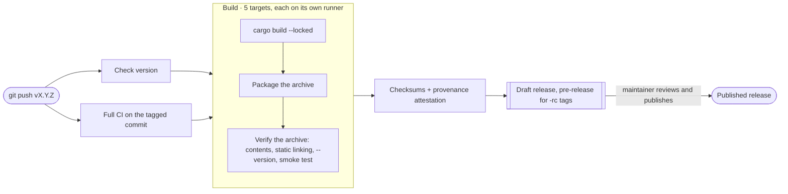

# Releasing mermdraw

Releases are cut by pushing a tag. `.github/workflows/release.yml` does the rest and stops at a **draft** release that
a maintainer reviews and publishes. The logic lives in [`scripts/release.sh`](../scripts/release.sh), so every step can
also be run locally.



## What a release contains

| Platform | Asset |
| --- | --- |
| Linux x86_64 (static, any distro) | `mermdraw-x86_64-unknown-linux-musl.tar.gz` |
| Linux arm64 (static, any distro) | `mermdraw-aarch64-unknown-linux-musl.tar.gz` |
| macOS, Apple silicon | `mermdraw-aarch64-apple-darwin.tar.gz` |
| macOS, Intel | `mermdraw-x86_64-apple-darwin.tar.gz` |
| Windows x64 | `mermdraw-x86_64-pc-windows-msvc.zip` |
| All of the above | `SHA256SUMS.txt`, plus a signed build-provenance attestation per archive |

Each archive holds one folder, `mermdraw-<target>/`, with the binary, `README.md`, `LICENSE` and `CHANGELOG.md`. Asset
names carry no version, so `https://github.com/berttoli/mermdraw/releases/latest/download/<asset>` always points at the
newest stable release (drafts and pre-releases are skipped).

## Versioning

mermdraw follows [semantic versioning](https://semver.org). While the version is `0.x`, a breaking change bumps the
minor version (0.1 → 0.2) and patch releases only fix bugs.

**Covered** by the compatibility promise, because it lives in users' repositories and scripts:

- CLI commands, flags and exit codes.
- The addon contract in [ADDONS.md](ADDONS.md): how `mermdraw NAME` finds and runs addons, the `--json` commands
  with their fields and exit codes, and the release layout `mermdraw addons add` downloads. Fields can be added, but
  not renamed, removed or given another meaning; a change that would break that bumps the `contract` number every
  JSON output carries.
- What mermdraw writes into repositories: the canonical structure of the mermaid it serializes, the
  `%% mermdraw:layout id:x,y …` comment, `.mermdraw/config.json`, `.mermdraw/icons/<pack>.json`, and uploads under
  `assets/`.

**Not covered:** the HTTP API under `/api/*` (internal to the editor), the UI, and anything behind a Labs flag, which
can change or disappear in any release. Changes to the serialized output's formatting are called out in the changelog
because they show up as diffs in users' repositories.

1.0 ships once the formats above have gone two or three minor releases without changes.

## One-time setup

- **Settings → Rules → Rulesets:**
  - `main`: require the CI checks (`Rust · ubuntu-latest`, `Rust · macos-latest`, `Rust · windows-latest`,
    `Web model · Node 22`, `Web model · Node 24`, `Package · static Linux binary`) and block force-pushes and deletion.
  - Tags `v*`: restrict creation, update and deletion to maintainers.
- **Settings → Actions → General:** the default read-only token is fine. Each job asks for exactly the permissions it
  needs, and only the publish job can write.
- **Optional, signed tags:** `git config gpg.format ssh`, `git config user.signingkey ~/.ssh/id_ed25519.pub`, add the
  key on GitHub as a *signing* key, then use `git tag -s`. Otherwise use `git tag -a`.

## Dry run (no tag, nothing released)

Run the pipeline from `main` without releasing anything:

```bash
gh workflow run release.yml --ref main      # or Actions → Release → Run workflow
gh run watch                                # then download the five archives from the run's artifacts
```

Locally, for the platform you're on:

```bash
cargo build --release --locked
scripts/release.sh package aarch64-apple-darwin target/release/mermdraw dist
scripts/release.sh verify dist/mermdraw-aarch64-apple-darwin.tar.gz
```

## Cutting a release

1. **Prepare on `main`.**
   - In `CHANGELOG.md`, rename `## Unreleased` to `## X.Y.Z — YYYY-MM-DD`. For the first release, fold the
     `Unreleased` items into the existing `0.1.0` section and update its date.
   - Set `version = "X.Y.Z-rc.1"` in `Cargo.toml` and run `cargo build` so `Cargo.lock` follows. The tag must match
     `Cargo.toml` exactly, so every build reports the version it really is (`mermdraw --version` →
     `mermdraw X.Y.Z-rc.1`).
   - If the release changes anything in [ADDONS.md](ADDONS.md) (the `--json` commands, `write`, addon lookup or
     `addons add`), run mermdraw-mcp's end-to-end and install tests against this build before tagging:

     ```bash
     cargo build --release --locked
     cd ../mermdraw-mcp   # a checkout of berttoli/mermdraw-mcp
     MERMDRAW_CORE=../mermdraw/target/release/mermdraw MERMDRAW_E2E_REQUIRED=1 cargo test --locked
     tests/install.sh ../mermdraw/target/release/mermdraw
     ```

     A breaking change must also bump `CONTRACT` in `src/main.rs`, with a release of mermdraw-mcp that speaks it.
   - Check, commit, push, and wait for CI to go green:

     ```bash
     scripts/release.sh check vX.Y.Z-rc.1
     git commit -am "Prepare vX.Y.Z-rc.1" && git push origin main
     ```

2. **Release candidate.** Tag and push it (`git tag -a` if you haven't set up signing):

   ```bash
   git tag -s vX.Y.Z-rc.1 -m "mermdraw X.Y.Z-rc.1"
   git push origin vX.Y.Z-rc.1
   ```

   This produces a draft **pre-release**. Download the assets, try them on a couple of machines, then either publish the
   draft for testers (`gh release edit vX.Y.Z-rc.1 --draft=false`) or delete it. If the rc needs fixes, land them on
   `main`, bump to `X.Y.Z-rc.2` and repeat.

3. **Stable.** Set `version = "X.Y.Z"`, run `cargo build`, commit "Release vX.Y.Z", push, then tag that commit:

   ```bash
   scripts/release.sh check vX.Y.Z
   git tag -s vX.Y.Z -m "mermdraw X.Y.Z"
   git push origin vX.Y.Z
   ```

   Review the draft's notes and assets, then publish it in the UI or with `gh release edit vX.Y.Z --draft=false`.

4. **After publishing,** add a fresh `## Unreleased` section to `CHANGELOG.md`.

## Verifying a release

What users (and you, before publishing) can check:

```bash
gh release download vX.Y.Z -R berttoli/mermdraw -p 'mermdraw-aarch64-apple-darwin.tar.gz' -p SHA256SUMS.txt
grep ' mermdraw-aarch64-apple-darwin.tar.gz$' SHA256SUMS.txt | shasum -a 256 -c
gh attestation verify mermdraw-aarch64-apple-darwin.tar.gz -R berttoli/mermdraw
```

The attestation proves the archive was built by this repository's release workflow from the tagged commit.

## When something goes wrong

- **The workflow fails before the draft exists.** Fix the problem on `main`, delete the tag
  (`git push --delete origin vX.Y.Z-rc.1 && git tag -d vX.Y.Z-rc.1`), and tag again. Prefer the next rc number.
- **The draft is wrong.** Delete it (`gh release delete vX.Y.Z --yes`) and the tag, fix, and tag again. Drafts are
  private, so reusing the version is fine.
- **A published release is broken.** Never move or reuse a published tag. Ship `X.Y.Z+1`, and edit the broken
  release's notes to point at it.

## How the pipeline is put together

| Piece | Where |
| --- | --- |
| Version, `Cargo.lock` and changelog checks; notes; packaging; artifact verification | `scripts/release.sh` |
| CLI + HTTP smoke test run against every packaged unix binary | `tests/smoke.sh` |
| Full test suite, reused on the tagged commit | `.github/workflows/ci.yml` (`workflow_call`) |
| Build matrix, draft release, attestations | `.github/workflows/release.yml` |
| Actions pinned to commit SHAs, bumped weekly | `.github/dependabot.yml` |

CI also builds, packages and verifies the static Linux archive on every push and pull request, so packaging problems
show up long before a tag.
