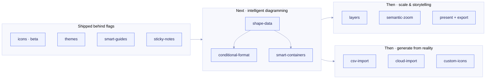

# Lucidchart & Miro → mermdraw: feature research and flag roadmap

*Researched 2026-10-26 from vendor product pages, help-center articles and community posts (sources at the end). Vendor
pages describe features, not quality, so treat the "what they offer" column as claims.*

## Summary

Lucidchart and Miro pull ahead of plain diagram-as-code in four areas:

1. **Styling systems:** preset themes, brand palettes, large shape and icon libraries, custom libraries.
2. **Structure:** containers, swimlanes and layers, where one diagram can switch between a high-level and a detailed view.
3. **Data-driven diagrams:** shape metadata, conditional formatting, data linking (CSV/Sheets), and diagrams generated
   from cloud accounts (Lucidscale).
4. **Presenting and collaborating:** presentation mode, comments, hotspots/actions, accessibility checks, AI assistants.

mermdraw's constraint is also its advantage: the source of truth is plain mermaid in git. So every candidate feature
below is classified by **how it is stored**:

| Storage class | Meaning | GitHub / other renderers |
| --- | --- | --- |
| **Portable** | Expressed in real mermaid syntax (shapes, `classDef`, frontmatter `config`) | Renders everywhere |
| **Enhanced** | Kept in mermaid comments (`%% mermdraw:…`) or packs installed locally | Degrades gracefully: the diagram still renders, the extra is ignored |
| **Tool-only** | Editor behaviour; nothing is written to the file | n/a |

Four flags shipped with this research so they can be tried immediately (open **⚗ Labs** in the editor):

| Flag | Stage | Storage | Inspired by |
| --- | --- | --- | --- |
| `icons` | beta (on) | Enhanced: `@{ icon: "logos:python" }` nodes + locally installed Iconify packs | Lucid shape libraries, Miro shape packs |
| `themes` | experimental | Portable: frontmatter `config` (`theme`, `themeVariables`, `look: handDrawn`, `flowchart.curve`) | Lucid preset themes |
| `smart-guides` | experimental | Tool-only | Lucid/Miro alignment guides |
| `sticky-notes` | experimental | Portable: a `sticky` classDef | Miro sticky notes |

Drill-down links (Lucid "hotspots", Miro "links to frames") are core, not flagged: any node's `click … href "./l2.md"`
opens that diagram, and a **← back** chip returns to the L1.

## What they offer

### Lucidchart

| Feature | What it is |
| --- | --- |
| Preset themes | Six styles per theme (primary, secondary, accent…) applied by shape role; manual styling wins over the theme |
| Shape libraries | Hundreds of libraries (UML, ERD, network, cloud), plus custom libraries shared across a team |
| Containers & Smart Containers | Group shapes; Smart Containers auto-group by a data attribute such as status |
| Swimlanes | Ownership lanes for process diagrams |
| Layers | Toggle layers to compare current vs future state |
| Custom shape data, formulas | Key/value metadata on shapes, formulas over it |
| Conditional formatting | Rules that restyle shapes meeting criteria (e.g. org-chart entries missing a role) |
| Data linking | Google Sheets / Excel / CSV linked to shapes; refresh and replace data sets |
| Dynamic shapes | Shapes such as progress bars that update with linked data |
| Auto-generation | Org charts, ERDs (SQL import/export), sequence diagrams and cloud architecture from data |
| Lucidscale / Cloud Accelerator | Import AWS, Azure and GCP accounts into diagrams; filter by VPC, tags, security groups; refresh to verify drift |
| Smart Lines, line jumps | Connectors re-route to the most efficient path; optional jumps where lines cross |
| Presentation Builder | Slides defined by frames on the canvas |
| Hotspots & actions | Turn shapes into buttons that navigate or trigger actions |
| Diagram as code | Mermaid and UML sequence markup, assisted layout |
| Lucid AI, MCP server, VS Code extension | Generate/refine diagrams, add formatting rules, summarize canvases |

### Miro

| Feature | What it is |
| --- | --- |
| Shape packs | Basic + flowchart free; BPMN, data flow, AWS, Azure, GCP, Cisco packs on paid plans; upload custom shapes |
| Branding | Logos, colour schemes, brand fonts applied across diagrams |
| Diagram layers | Per-diagram layers to switch between a high-level and a detailed view (Oct 2024) |
| Smart containers, shape metadata, tags, auto-layout | "Power user" diagramming features (draw.io app by Miro) |
| CSV org charts | Imported data is laid out as cards automatically |
| Presentation mode | Frame-by-frame presenting with a grid view, can drop back to the free canvas |
| Accessibility | Named colours for colour-blind users, an accessibility checker (missing descriptions, poor contrast), AI alt text |
| Templates & Blueprints | Reusable structures for architecture reviews, sprint planning |
| Mermaid diagrams, PlantUML app, draw.io import | Code-based diagrams alongside the whiteboard |
| Miro AI, MCP server | Diagram/flowchart generators, clustering, AI workflows |

## Candidate flags

Effort: **S** ≈ a day, **M** ≈ a few days, **L** ≈ a week or more.

| Flag | Inspired by | What it would do in mermdraw | Storage | Effort |
| --- | --- | --- | --- | --- |
| `shape-data` | Lucid custom shape data, Miro metadata | Key/value table per node in the inspector (owner, tier, status, cost) | Enhanced: `%% mermdraw:data api owner=payments tier=1` | M |
| `conditional-format` | Lucid conditional formatting | Rules like `status = deprecated → red dashed` compiled to `classDef` + `class` lines | Portable output | M |
| `smart-containers` | Lucid Smart Containers | Re-group nodes into subgraphs by a data field (team, domain, environment) | Portable output | M |
| `layers` | Lucid layers, Miro diagram layers | Tag nodes `current` / `future` / `security`; toggle visibility; preview renders only visible layers | Enhanced (class tags) | M |
| `semantic-zoom` | Miro high-level ↔ detailed views | Zooming into an L1 node that links to an L2 renders the L2 inside it, without leaving the L1 | Tool-only | L |
| `csv-import` | Lucid data linking, Miro CSV org charts | `mermdraw import org.csv` → org chart / landscape; `--refresh` keeps positions | Portable output | M |
| `cloud-import` | Lucidscale, Cloud Accelerator | `mermdraw import terraform` (from `terraform show -json`) or `gcloud asset` exports → an L2 diagram with icons; re-run to show drift | Portable output | L |
| `custom-icons` | Lucid custom libraries, Miro custom shapes | `mermdraw icons import ./brand-svgs --name acme` builds an Iconify pack from a folder of SVGs | Enhanced | S |
| `format-painter` | Lucid/Miro style copy | Copy fill/stroke/class from one node, paste onto others | Portable output | S |
| `smart-lines` | Lucid Smart Lines | Obstacle-avoiding orthogonal routing on the canvas (mermaid already has `curve: step`) | Tool-only | M |
| `line-jumps` | Lucid line jumps | Arcs where connectors cross (canvas only; mermaid can't express them) | Tool-only | S |
| `swimlanes` | Lucid swimlanes | Lane template: stacked subgraphs with shared width and ordering | Portable | S |
| `minimap` | Miro board map | Overview of large canvases with a draggable viewport | Tool-only | S |
| `present` | Lucid Presentation Builder, Miro presentation mode | Step through diagrams (and groups) of a file full-screen; arrow keys; drill-down links work | Tool-only | M |
| `export` | Both | PNG/PDF export at 2×, plus "copy as image" | Tool-only | S |
| `a11y-check` | Miro accessibility checker | Lint missing `accTitle`/`accDescr`, low-contrast fills, colour-only meaning | Portable (`accTitle`/`accDescr`) | S |
| `ai-assist` | Lucid AI, Miro AI | "Turn this paragraph into an L2", "group by team", powered by a user-supplied API key | Tool-only | M |
| `templates` | Lucid premium templates, Miro templates | Gallery: C4 L1/L2, landing zone, data platform, incident flow | Portable | S |

**Why this order:** `shape-data` is the foundation that conditional formatting, smart containers, layers and the
importers all build on. It is the heart of what Lucid calls "intelligent diagramming", and it stays portable because its
outputs are ordinary `classDef`/`subgraph` statements. Layers and semantic zoom then make the L1→L2 story work on one
canvas. The importers come last: they are the most valuable for keeping docs true to production, but they need the
data model to be in place first.

## How flags work in mermdraw

- **Registry:** `web/flags.js` lists every flag with a stage (`experimental` ships off, `beta` ships on), a description
  and its inspiration.
- **Precedence (later wins):** built-in default → project `.mermdraw/config.json` (`{"flags": {"themes": true}}`) →
  command line (`mermdraw --enable themes,smart-guides`, `--disable icons`) → this browser (Labs panel, stored in
  localStorage). The Labs panel shows where each value comes from and can reset a personal override.
- **Lifecycle:** experimental → beta (default on, can still be disabled) → graduated (the flag is deleted and the code
  path becomes normal) or removed (code deleted). A flag shouldn't sit in beta for more than a couple of releases.
- **Graduation checklist** for each flag:
  - Diagrams written with it still render on GitHub, or degrade there visibly but harmlessly.
  - Round-trip tests exist (`tests/model.test.mjs`); output is stable and diff-friendly.
  - Turning the flag off never corrupts or rewrites existing files.
  - It stays responsive with ~300 nodes.
  - It works in light and dark mode.

## Notes on portability

- **Icons:** `@{ icon: … }` nodes need mermaid ≥ 11.3 *and* registered icon packs. mermdraw registers the installed
  packs for its preview. GitHub offers no way to register packs, so expect mermaid's placeholder icon there (labels and
  structure still render). That is why the example keeps L1 to classic shapes and puts icons in L2.
- **Themes:** frontmatter `config` needs mermaid ≥ 10.5. Avoid frontmatter `title:` with light `base` palettes, because
  it is drawn in `primaryTextColor` and disappears in GitHub's dark mode.
- **Layout:** mermaid has no manual positions. mermdraw keeps canvas positions in a `%% mermdraw:layout` comment and the
  preview shows mermaid's own layout, which is exactly what other renderers will draw.

## Sources

- Lucidchart product page — https://lucid.co/product/lucidchart
- Lucidchart vs draw.io (feature list) — https://lucid.co/blog/reasons-to-use-lucidchart-vs-drawio
- Lucid preset themes — https://help.lucid.co/hc/en-us/articles/31943184130452
- Lucid shortcuts / Smart Lines — https://app.lucid.co/blog/lucidchart-shortcuts
- Line jumps (community) — https://community.lucid.co/product-questions-3/how-to-turn-on-off-line-jumps-in-lucidchart-2834
- Presentation Builder — https://lucid.co/blog/11-lucidchart-features-to-increase-productivity
- Lucidscale cloud diagrams — https://lucid.co/cloud/system-architecture-diagram, https://lucid.co/lucidscale/compare/lucidscale-vs-cloudcraft
- Miro technical diagramming customization — https://miro.com/technical-diagramming/customization/
- Miro vs Lucidchart (plans, shape packs) — https://miro.com/compare/miro-vs-lucidchart/diagramming
- Miro layers announcement — https://community.miro.com/ideas/layers-93
- Miro presentation mode — https://help.miro.com/hc/articles/34307373858450-Presentation-mode
- draw.io app by Miro (smart containers, metadata, tags) — https://community.miro.com/product-news-31/draw-io-app-by-miro-14796
- Iconify packs used by mermdraw — `@iconify-json/logos` 1.2.16 (CC0-1.0), `@iconify-json/devicon` 1.2.71 (MIT)
