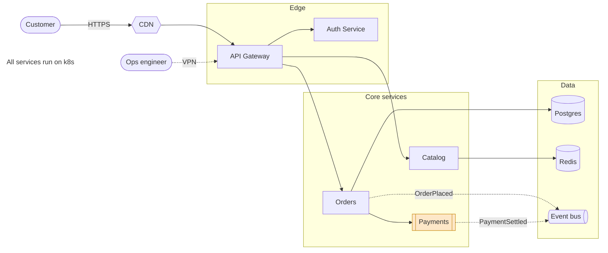
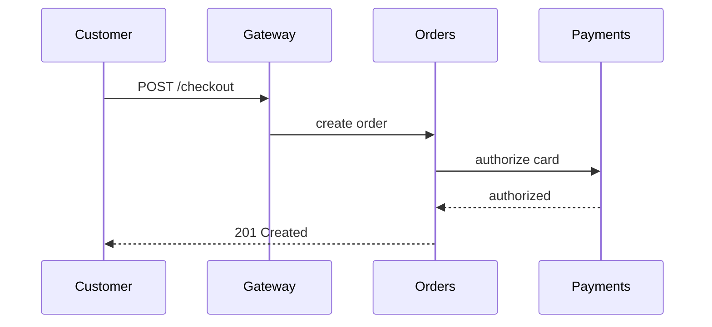
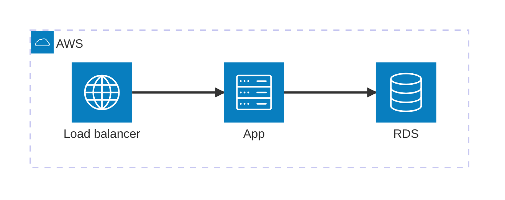

# Shop Platform Architecture

This file is the source of truth for the platform's architecture. Edit it with
`mermdraw examples/architecture.md` (visual) or any text editor — both stay in sync.

## System overview

## Checkout flow

## Deployment

