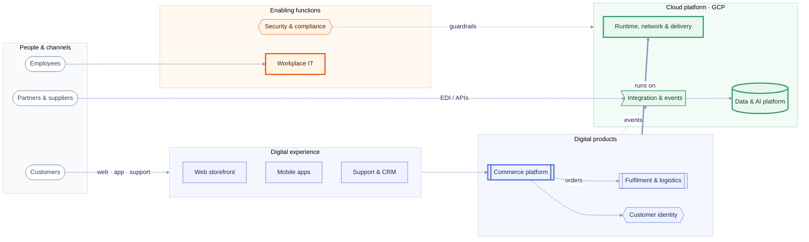

# Northwind Technology — IT organization & architecture

A worked example of a whole IT organization documented as code. **L1** (this file) uses only
mermaid's default shapes plus a theme, so it renders the same in mmdr, on GitHub and anywhere else
mermaid runs. Each L1 box with a **thick border** has an **L2** drill-down with the concrete
products and runtimes, drawn with icon packs:

```bash
mmdr icons add logos devicon      # once per machine (or --vendor to commit them with the repo)
mmdr examples/it-org/README.md    # ⌘-click a thick-bordered box to drill into its L2
```

| L2 | What it shows |
| --- | --- |
| [Digital products](l2-digital-products.md) | storefront, APIs (Python, Rust, Go), state and payments |
| [Cloud platform](l2-cloud-platform.md) | GCP landing zone, GKE / Cloud Run, delivery and observability |
| [Data & AI](l2-data-ai.md) | ingestion, BigQuery, dbt, Looker, Vertex AI |
| [Workplace IT](l2-workplace-it.md) | identity, collaboration SaaS, devices and the on-prem lab |

## L1 · Organization

Who owns what. Teams map onto the capabilities in the landscape below.

```mermaid
---
config:
  theme: base
  themeVariables:
    primaryColor: "#EEF2FF"
    primaryBorderColor: "#4F6BED"
    primaryTextColor: "#1E2457"
    lineColor: "#8A93BF"
    clusterBkg: "#F7F8FD"
    clusterBorder: "#C3CBF3"
    fontFamily: "Inter, ui-sans-serif, system-ui, sans-serif"
---
flowchart TD
    cto([CTO · Technology leadership])
    subgraph product [Product Engineering]
        direction TB
        commerceTeam[Commerce squads]
        fulfilmentTeam[Fulfilment squad]
        mobileTeam[Mobile squad]
    end
    subgraph platformOrg [Platform & SRE]
        direction TB
        cloudTeam[Cloud platform team]
        sreTeam[SRE & incident response]
        devexTeam[Developer experience]
    end
    subgraph dataOrg [Data & AI]
        direction TB
        dataEng[Data engineering]
        analytics[Analytics & BI]
        mlTeam[ML engineering]
    end
    subgraph secOrg [Security & GRC]
        direction TB
        secOps[Security operations]
        grc[Governance, risk & compliance]
    end
    subgraph witOrg [Workplace IT]
        direction TB
        serviceDesk[Service desk]
        identityTeam[Identity & access]
        endpoint[Endpoint & SaaS]
    end
    archOffice{{Architecture office · standards & reviews}}
    cto --> product
    cto --> platformOrg
    cto --> dataOrg
    cto --> secOrg
    cto --> witOrg
    cto -.-> archOffice
    classDef lead fill:#1E2457,stroke:#1E2457,color:#FFFFFF
    classDef office fill:#FFF4E6,stroke:#E8590C,color:#4A1D05
    class cto lead
    class archOffice office
    style product fill:#F5F7FF,stroke:#4F6BED
    style platformOrg fill:#F2FBF6,stroke:#2F9E6B
    style dataOrg fill:#F4F2FF,stroke:#7C5CDB
    style secOrg fill:#FFF5F5,stroke:#D64545
    style witOrg fill:#FFF9EF,stroke:#D9902A
```



## L1 · Landscape

How customers, staff and partners reach the capabilities, and what those capabilities run on.


