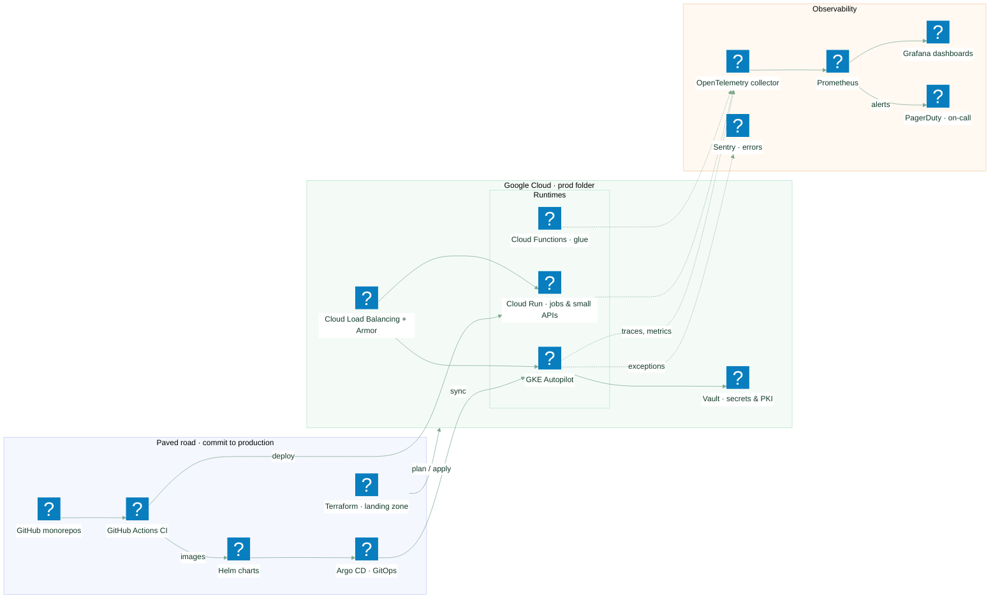

# L2 · Cloud platform

Drill-down of **Runtime, network & delivery** from the [L1 landscape](README.md): the GCP landing
zone, the paved road from commit to production, and how production is observed.

