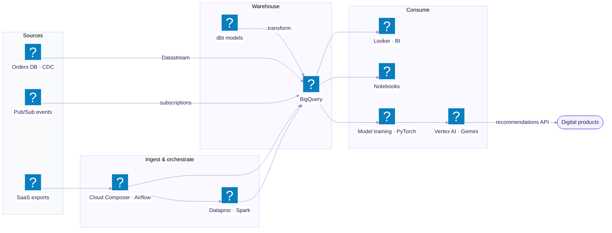

# L2 · Data & AI

Drill-down of **Data & AI platform** from the [L1 landscape](README.md). Operational data and events
land in BigQuery, dbt models them, Looker serves analysts, and Vertex AI serves models back to the
products.

