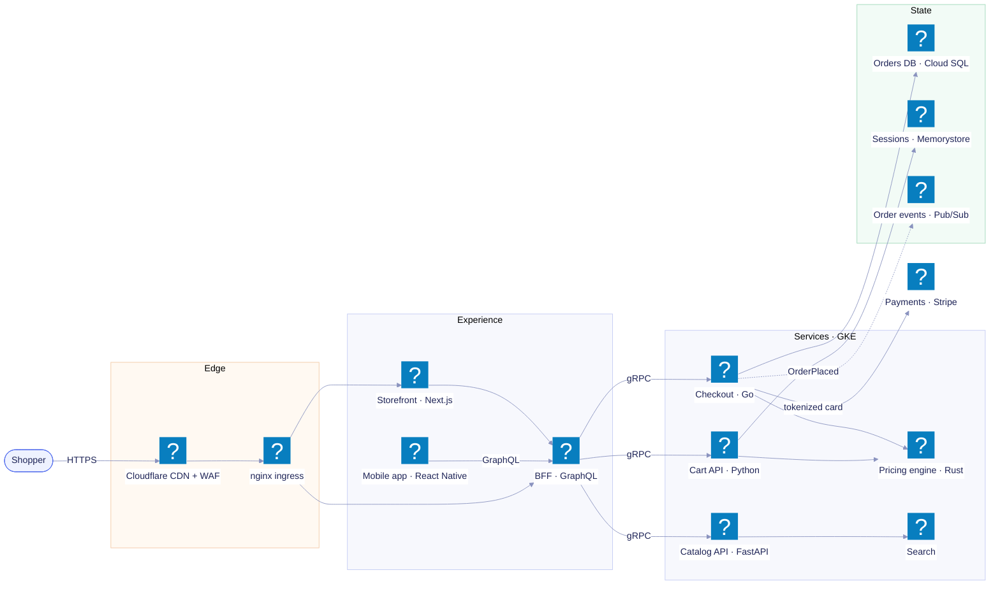

# L2 · Digital products

Drill-down of **Commerce platform** from the [L1 landscape](README.md). Product logos come from the
`logos` icon pack (`mmdr icons add logos`); without it, mermaid shows placeholder icons but keeps
the labels and structure.

