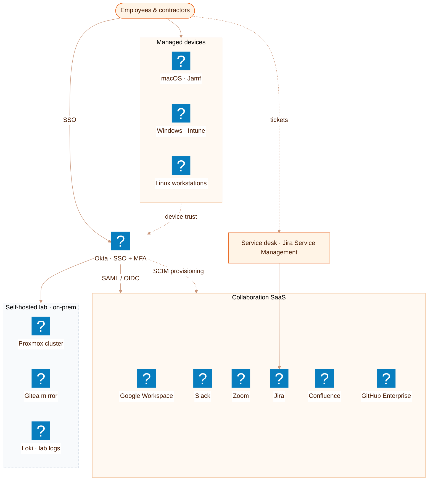

# L2 · Workplace IT

Drill-down of **Workplace IT** from the [L1 landscape](README.md): identity, collaboration SaaS,
managed devices, and the self-hosted lab. Mixes the `logos` and `devicon` packs.

